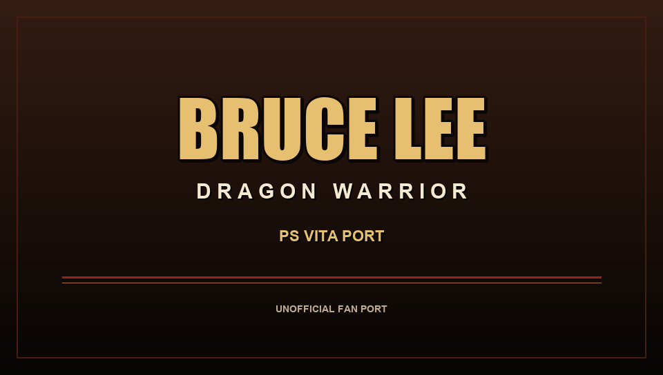

<p align="center">
  
</p>

# Bruce Lee: Dragon Warrior — PS Vita (unofficial port)

Unofficial port of the Android game **Bruce Lee: Dragon Warrior** (Digital
Legends / Sony Ericsson / Indiagames, v1.15.26, `armeabi`) to the **PS Vita**,
using [vitaGL](https://github.com/Rinnegatamante/vitagl) and the
`so_util`/FalsoJNI ecosystem.

> **Legal notice:** this is an unofficial fan project, not affiliated with or
> endorsed by the rights holders. The repository and the released VPK **do not
> contain** the APK, the game's `.so` libraries, content packages, textures,
> sounds, or saves. You must provide a **legally obtained copy** of the Android
> game. Read [`LEGAL.md`](LEGAL.md) before installing or redistributing.

**Repository:** <https://github.com/lferrete/brucelee-vita>  
**Release:** <https://github.com/lferrete/brucelee-vita/releases/latest>

---

## Status

- Tested with the Android version **1.15.26** (`armeabi`).
- Native **960×544** rendering via vitaGL, ~60 FPS.
- Audio (music + SFX) through `AudioTrack` → `sceAudioOut`, with a 44.1→48 kHz
  FIR resampler.
- Physical and touch controls:
  - D-pad and left analog stick move the character.
  - Square/Triangle punch; Cross/Circle kick.
  - Start pauses.
  - Cross confirms in menus; Circle goes back/closes the pause menu.
  - The Vita front touch screen works.
- Save/config work in `ux0:data/brucelee/save/`.
- The VPK is **loader-only**; the game data stays outside it.

## Requirements

1. PS Vita/PSTV with CFW (HENkaku/Enso).
2. [kubridge](https://github.com/TheOfficialFloW/kubridge/releases) kernel
   plugin.
3. [FdFix](https://github.com/TheOfficialFloW/FdFix/releases) (recommended).
4. `libshacccg.suprx` in `ur0:data/` — install via
   [ShaRKBR33D](https://github.com/Rinnegatamante/ShaRKBR33D/releases) or the
   [extraction guide](https://samilops2.gitbook.io/vita-troubleshooting-guide/shader-compiler/extract-libshacccg.suprx).
5. A **legally obtained copy** of the Android APK and the game's `data.zpak`.
6. Free space in `ux0:` for the data (~220 MB) and the VPK.

## Installation (players)

### 1. Install the plugins

Copy `kubridge.skprx` and `fd_fix.skprx` to `ux0:tai/` and add to
`ux0:tai/config.txt`:

```
*KERNEL
ux0:tai/kubridge.skprx
ux0:tai/fd_fix.skprx
```

> If you use `rePatch`, do not install `fd_fix.skprx`.

Reboot the console. Install `libshacccg.suprx` in `ur0:data/`.

### 2. Download the VPK

Get the latest VPK from the repository's **Releases** tab. It contains only the
loader and neutral LiveArea art — **not** the game.

### 3. Prepare the game data

Extract from your legal copy:

```
ux0:data/brucelee/
  lib/armeabi/libdefault.so
  lib/armeabi/libzplatform.so
  lib/armeabi/libjava-activity.so
  assets/BruceLee.zpak
  content/Core.pakh
  content/Core.pakd000
  content/data.zpak
  metadata.xml
  game/metadata.xml
  logs/
  shader_cache/
```

- From the APK: `lib/armeabi/libdefault.so`, `libzplatform.so`,
  `libjava-activity.so`, `assets/BruceLee.zpak`.
- From `data.zpak`: `Core.pakh`, `Core.pakd000` and the container
  `metadata.xml`.
- The root `metadata.xml` and `game/metadata.xml` must be the **application
  manifest** (with `<platforms><platform type="android">`), extracted from
  `assets/BruceLee.zpak`.
- Also copy `data.zpak` to `content/data.zpak`.

On Windows, `tools/prepare_data.ps1` automates the extraction:

```powershell
powershell -ExecutionPolicy Bypass -File tools\prepare_data.ps1
```

It looks for the APK and `data.zpak` in the project's parent folder; you can
also pass `-Apk` and `-Zpak` explicitly. The output is written to `data/`;
copy its contents to `ux0:data/brucelee/`.

> The repository does **not** include the APK, `data.zpak`, `.so` files,
> `.pakh/.pakd` packages, or any game asset. Do not ask for, post, or link
> those files in issues.

### 4. Install and launch

Install the VPK with VitaShell, launch the game, and choose **YES** on the
"enable sound" screen. Without YES, the game stays muted.

## Controls

| Vita | Action |
|---|---|
| D-pad / left analog stick | move the character |
| Square / Triangle | punch |
| Cross / Circle | kick |
| Start | pause |
| Cross | confirm / enter options |
| Circle | back (menus) / close pause |
| Touch screen | HUD, menus and the game's original touch input |

In the pause menu, Cross confirms and Circle closes the menu; in submenus,
Circle goes back. Select is not required to play.

## Audio

- Choose **YES** on "enable sound".
- The game's volume is stored in its save/config (`sound_volume`,
  `music_volume`).
- The port does not change the system volume.
- If audio is muted, check the YES prompt, the Vita volume, and the log
  (`AudioTrack`, `[at]`).

## Troubleshooting

- **Black screen / returns to LiveArea:** check kubridge/FdFix, the
  `libshacccg.suprx` file, and that the data matches the layout above.
- **"Missing shared object":** a `.so` is missing from
  `ux0:data/brucelee/lib/armeabi/`.
- **Package not found:** `Core.pakh`/`Core.pakd000` or `content/data.zpak` is
  missing.
- **No audio:** choose YES; check `ux0:data/brucelee/logs/`.
- **Old LiveArea art cached:** reboot the console or refresh the LiveArea.
- **Strange controls:** remove pad-remapping/overlay plugins; the port already
  maps D-pad, analog, face buttons and touch.

Logs:

```
ux0:data/brucelee/logs/brucelee_NNN.log
```

When reporting a bug, include the relevant log excerpt and your game/console
versions. **Never** attach the APK, `.so` files, packages, or saves.

Detailed guide: [`docs/INSTALL.md`](docs/INSTALL.md) and
[`docs/TROUBLESHOOTING.md`](docs/TROUBLESHOOTING.md).

## Building from source

Requirements: a softfp VitaSDK, MSYS2 (make/cmake), and the vendored libraries
in `lib/` (vitaGL, vitaShaRK, kubridge, FalsoJNI, so_util, fios, sha1).

```bash
cd brucelee-vita
bash build.sh     # configure CMake
bash make.sh      # build
```

Build the VPK with:

```powershell
powershell -ExecutionPolicy Bypass -File tools\make_vpk.ps1
# build/brucelee.vpk + build/SHA256SUMS.txt
```

The public release uses neutral LiveArea art generated by
`tools/make_neutral_livearea.py` (no game assets).

### Optional personal LiveArea

`tools/make_livearea.py` can generate a personal LiveArea from the icon in
**your own legally obtained APK**. The output goes to
`extras/livearea_personal/` (git-ignored) and is derived from copyrighted game
art: use it only on your own console and **do not commit or distribute it**.

```powershell
py -3 tools\make_livearea.py
powershell -ExecutionPolicy Bypass -File tools\make_vpk.ps1 `
  -ArtDir extras\livearea_personal `
  -LoadingFile extras\loading_personal.rgb565 `
  -OutFile build\brucelee-personal.vpk
```

The public repository/release intentionally stays neutral for legal safety.

## Data and privacy

- `data/`, `build/`, saves, logs and game-derived art are in `.gitignore`.
- The release VPK does not contain game data.
- The port has no telemetry and collects no data.

## Credits

- **Port, loader, integration, input/audio, documentation:** Leandro Ferrete.
- **Original game:** Digital Legends / Sony Ericsson / Indiagames.
- **so_util:** TheFloW (Andy Nguyen), Rinnegatamante.
- **FalsoJNI:** Volodymyr Atamanenko and contributors.
- **vitaGL:** Rinnegatamante and contributors.
- **kubridge:** TheFloW.
- **vitaShaRK/SceShaccCg:** Rinnegatamante and contributors.
- **VitaSDK, fios, sha1, zlib, newlib:** their respective authors.

See [`AUTHORS.md`](AUTHORS.md) and [`LICENSE`](LICENSE).

## Documentation

- [`docs/INSTALL.md`](docs/INSTALL.md) — step-by-step installation.
- [`docs/BUILDING.md`](docs/BUILDING.md) — build and package.
- [`docs/TROUBLESHOOTING.md`](docs/TROUBLESHOOTING.md) — common problems.
- [`docs/AUTHORSHIP.md`](docs/AUTHORSHIP.md) — authorship and verification.
- [`docs/PUBLISHING.md`](docs/PUBLISHING.md) — publishing and repository
  protection.
- [`LEGAL.md`](LEGAL.md) — legal notice and takedown.
- [`CONTRIBUTING.md`](CONTRIBUTING.md) — contribution rules.
